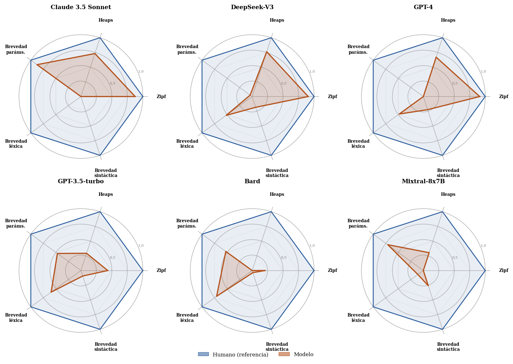

# Leyes estadísticas del lenguaje y detección de textos robóticos

**Materiales de replicación del artículo en *Linguamática*** · [Zenodo](https://doi.org/10.5281/zenodo.XXXXXXX) · [Cómo citar](#cómo-citar) · [Cambios](CHANGELOG.md)

<!-- Tras publicar en Zenodo, sustituir XXXXXXX por el número del DOI (aquí y en «Cómo citar») -->

Este repositorio reúne el código, los resultados y las figuras del artículo:

> Moyano-Moreno, I. **Las leyes estadísticas del lenguaje como marcador de estilo para la detección de textos robóticos en español** / *Statistical Laws of Language as a Stylometric Fingerprint for Machine-Generated Text Detection in Spanish*. *Linguamática*.

El trabajo comprueba si las leyes estadísticas del lenguaje permiten distinguir artículos científicos en español escritos por personas de los generados por seis LLMs (Bard, Claude 3.5 Sonnet, DeepSeek-V3, GPT-3.5-turbo, GPT-4 y Mixtral-8x7B). Para ello se usa un panel pareado de 90 artículos × 7 autores (630 textos) del corpus ROBOT-TALK.

*English summary.* Replication materials for a study testing whether 15 vocabulary-independent features derived from Zipf's law, Heaps' law and the brevity principle can tell human-written Spanish scientific articles apart from those generated by six LLMs. The corpus is not redistributed; the extracted features are included. Code comments and outputs are in Spanish.

<p align="center"></p>

## Qué contiene

- **15 rasgos estilométricos** que no dependen de ninguna palabra concreta, agrupados según la ley de Zipf, la ley de Heaps y el principio de brevedad (léxico y oracional);
- **pruebas estadísticas** entre textos humanos y robóticos (Mann-Whitney, Wilcoxon pareado y *d* de Cohen);
- **clasificación** humano frente a robótico (T1) e identificación del modelo (T2), con validación cruzada agrupada por artículo;
- **ablación** por grupos de rasgos, tasa de falsos positivos y comparación con dos líneas base (Delta de Burrows y n-gramas de caracteres);
- **análisis de sensibilidad** al tamaño de la ventana;
- todas las **figuras** del artículo.

## Estructura

```text
.
├── data/          aquí se coloca el corpus (no incluido)
├── scripts/       código Python, numerado en orden de ejecución
│   ├── functions.py              funciones de cálculo de los rasgos
│   ├── 01_descriptivas.py
│   ├── 02_extraccion_rasgos.py
│   ├── …
│   └── 12_figuras_leyes.py
├── results/       tablas CSV con los resultados
├── figures/       figuras del artículo (PDF y PNG)
├── run_all.sh     ejecuta todo el flujo en orden
├── requirements.txt
├── CHANGELOG.md
├── CITATION.cff
└── LICENSE
```

## Instalación

Con Python 3.11:

```bash
pip install -r requirements.txt
python -m spacy download es_core_news_sm
```

## Corpus

Los análisis parten del corpus **ROBOT-TALK** (Alonso et al., 2024), que **no se distribuye** en este repositorio. Para ejecutar el flujo completo hay que solicitar acceso a sus autores y colocar el fichero en:

```text
data/corpus_robot-talk_2026-02-04.csv
```

Sin el corpus pueden ejecutarse todos los pasos posteriores a la extracción, porque `results/estadisticas_textos.csv` contiene los rasgos ya calculados (sin texto) para las 100 ventanas de cada uno de los 630 textos.

## Uso

Los scripts se ejecutan **desde la raíz del repositorio**. Para lanzar todo el flujo:

```bash
./run_all.sh
```

O paso a paso, en este orden:

| Paso | Script | Corpus | Qué hace | Salida |
|---|---|---|---|---|
| 1 | `01_descriptivas.py` | sí | Longitud de los textos del panel 90 × 7 | `descriptivas_articulos_90x7.csv` |
| 2 | `02_extraccion_rasgos.py` | sí | Extrae los rasgos en 100 ventanas de 400 *tokens* por texto | `estadisticas_textos.csv` |
| 3 | `03_analisis_estadistico.py` | no | Mann-Whitney, Wilcoxon pareado y *d* de Cohen | `analisis_global.csv`, `analisis_pareado_global.csv` |
| 4 | `04_clasificacion.py` | no | Identificación multiclase del autor (T2) | `clasificacion_multiclase_autor.csv`, `estadisticas_por_texto.csv` |
| 5 | `05_ablacion.py` | no | Ablación por grupos de rasgos (T1) | `ablacion.csv` |
| 6 | `06_falsos_positivos.py` | no | Falsos positivos (humano → robótico) | `fpr_ablacion.csv` |
| 7 | `07_baseline_delta.py` | sí | Línea base Delta de Burrows (200 MFW) | `baseline_delta.csv` |
| 8 | `08_baseline_chargrams.py` | sí | Línea base de n-gramas de caracteres y F1 por clase en T2 | `t2_perclass_f1.csv` |
| 9 | `09_sensibilidad_ventana.py` | sí | Sensibilidad al tamaño de ventana | `sensitivity_ventana.csv` |
| 10 | `10_figuras_resultados.py` | no | Diagramas de caja, ablación, curvas ROC y dispersión | `figures/` |
| 11 | `11_figuras_radar.py` | no | Radares humano frente a cada modelo | `figures/radar_individuales.*` |
| 12 | `12_figuras_leyes.py` | sí | Figuras ilustrativas de las tres leyes | `figures/ley_{zipf,heaps,brevedad}.*` |

Las tablas se guardan en `results/`.

Algunos detalles del procedimiento:

- **Orden.** `03` y `04` escriben ambos `results/estadisticas_por_texto.csv`; vale la versión de `04` (con la columna `author`), que es la que usa `08`.
- **Semilla fija** (`seed = 42`) en el muestreo de ventanas y en las particiones de validación cruzada.
- **Validación cruzada** con `GroupKFold` (k = 5) agrupando por artículo, de modo que las versiones de un mismo artículo nunca están a la vez en entrenamiento y prueba.
- **Texto del corpus.** `02` guarda también `results/corpus_balanceado.csv`, que contiene texto del corpus; está excluido en `.gitignore` y no debe publicarse.

## Cómo citar

Si utiliza estos materiales, cite el artículo y este repositorio (ver [`CITATION.cff`](CITATION.cff)):

> Moyano-Moreno, I. (2026). *Leyes estadísticas del lenguaje y detección de textos robóticos: código y resultados* (v1.0.0) [Software]. Zenodo. https://doi.org/10.5281/zenodo.XXXXXXX

## Licencia

Código y resultados bajo licencia MIT (ver [`LICENSE`](LICENSE)). El corpus ROBOT-TALK no forma parte de este repositorio y se rige por sus propias condiciones.

## Contacto y financiación

Isabel Moyano-Moreno · Instituto Universitario de Investigación en Lingüística Aplicada, Universidad de Cádiz · isabel.moyano@uca.es

Proyecto «ROBOT-TALK: Reconocimiento del origen robótico de textos. Automatización de tareas y conocimiento lingüístico» (PID2022-140897OB-I00), financiado por MCIN/AEI/10.13039/501100011033 y por la Unión Europea (FEDER). Ayuda predoctoral FPU21/03261 del Ministerio de Universidades.
